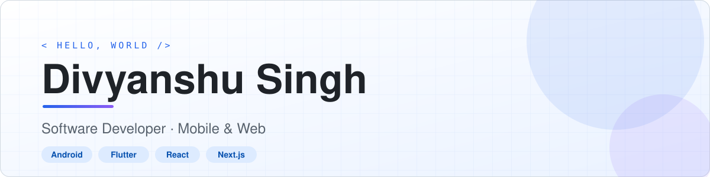

<picture>
  <source media="(prefers-color-scheme: dark)" srcset="./assets/profile-banner-dark.svg">
  <source media="(prefers-color-scheme: light)" srcset="./assets/profile-banner-light.svg">
  
</picture>

  <a href="#about"><b>About</b></a> &nbsp;•&nbsp;
  <a href="#selected-work"><b>Work</b></a> &nbsp;•&nbsp;
  <a href="#toolkit"><b>Toolkit</b></a> &nbsp;•&nbsp;
  <a href="#activity"><b>Activity</b></a> &nbsp;•&nbsp;
  <a href="#connect"><b>Connect</b></a>

## About

I build software across **mobile and web**, with hands-on experience in Android, Flutter, React and Next.js. I’m interested in clean application architecture, useful product experiences and turning ideas into working software.

|  |  |
|:--|:--|
| **Focus** | Mobile development · Frontend engineering · Clean architecture |
| **Exploring** | AI-assisted development · Interactive 3D · Game development |

## Selected work

<b>8 FEATURED PROJECTS &nbsp;·&nbsp; MOBILE · WEB · PRODUCTIVITY</b>

 

<table width="100%" cellpadding="16">
<tr>
<td width="50%" valign="top">

### [NullMark ↗](https://github.com/divyanshu15/nullmark)
<b>01 · PRIVACY / WEB</b>

Browser-based utilities for inspecting and processing images, PDFs, audio, code and text. Built with a local-first approach.

  

 

[**View repository →**](https://github.com/divyanshu15/nullmark)

</td>
<td width="50%" valign="top">

### [Panji Mobile ↗](https://github.com/divyanshu15/panji-mobile)
<b>02 · BUSINESS / MOBILE</b>

Flutter app prototype for invoice creation, document scanning, vendor records and EMI calculations, with local data storage.

  

 

[**View repository →**](https://github.com/divyanshu15/panji-mobile)

</td>
</tr>
<tr>
<td width="50%" valign="top">

### [ShopSaver ↗](https://github.com/divyanshu15/ShopSaver)
<b>03 · COUPONS / MOBILE</b>

Coupon application with phone authentication, API integration, reactive UI state and local persistence.

  

 

[**View repository →**](https://github.com/divyanshu15/ShopSaver)

</td>
<td width="50%" valign="top">

### [Food Runner ↗](https://github.com/divyanshu15/Food-Runner)
<b>04 · FOOD / MOBILE</b>

Food ordering client covering restaurant discovery, menus, cart management, favorites and order history.

  

 

[**View repository →**](https://github.com/divyanshu15/Food-Runner)

</td>
</tr>
<tr>
<td width="50%" valign="top">

### [NearByPlaces ↗](https://github.com/divyanshu15/NearByPlaces)
<b>05 · MAPS / LOCATION</b>

Location-aware place discovery using device location, Google Maps and the Places API.

  

 

[**View repository →**](https://github.com/divyanshu15/NearByPlaces)

</td>
<td width="50%" valign="top">

### [GroceryApp ↗](https://github.com/divyanshu15/GroceryApp)
<b>06 · PRODUCTIVITY / MOBILE</b>

A lightweight grocery list manager structured around MVVM, Room persistence and observable UI state.

  

 

[**View repository →**](https://github.com/divyanshu15/GroceryApp)

</td>
</tr>
<tr>
<td width="50%" valign="top">

### [NewsApp ↗](https://github.com/divyanshu15/NewsApp)
<b>07 · NEWS / ANDROID</b>

News reader with category-based headlines, remote API integration, article thumbnails and in-app browsing.

  

 

[**View repository →**](https://github.com/divyanshu15/NewsApp)

</td>
<td width="50%" valign="top">

### [GFGAssignment ↗](https://github.com/divyanshu15/GFGAssignment)
<b>08 · RSS / ANDROID</b>

RSS-powered reader with feed conversion, article lists, image loading and swipe-to-refresh.

  

 

[**View repository →**](https://github.com/divyanshu15/GFGAssignment)

</td>
</tr>
</table>

<b>Technical notes across the projects</b>

 

- **NullMark:** Local-first file inspection and selected metadata processing.
- **Panji Mobile:** Invoice creation, scanner flow, vendor records and EMI calculator interface.
- **ShopSaver:** Firebase phone authentication, Retrofit networking and Room persistence.
- **Food-Runner:** Restaurant/menu browsing, cart, favorites and order history.
- **NearByPlaces:** Fused location provider, Google Maps and Places API.
- **GroceryApp:** Room database, DAO, Repository, ViewModel and LiveData.
- **NewsApp:** News API, Retrofit, Gson, Glide, fragments and RecyclerView.
- **GFGAssignment:** RSS2JSON, Retrofit, Glide and swipe-to-refresh.

## Toolkit

| Domain | Technologies |
|:--|:--|
| **Mobile** | Flutter · Dart · Kotlin · Java · Android |
| **Web** | React · Next.js · TypeScript · JavaScript · Tailwind CSS |
| **APIs & services** | REST APIs · Firebase · Retrofit · Volley |
| **Data** | SQLite · Room · MongoDB |
| **Patterns** | MVVM · Repository Pattern · ViewModel · LiveData |

## Activity

<picture>
  <source media="(prefers-color-scheme: dark)" srcset="https://raw.githubusercontent.com/divyanshu15/divyanshu15/output/github-contribution-grid-snake-dark.svg">
  <source media="(prefers-color-scheme: light)" srcset="https://raw.githubusercontent.com/divyanshu15/divyanshu15/output/github-contribution-grid-snake.svg">
  
</picture>

Contribution snake refreshed daily by GitHub Actions.

## Currently exploring

- Scalable application architecture and software quality
- Modern full-stack product development
- AI-assisted engineering and automation
- Interactive 3D experiences and game development

## Connect

 

<i>Build useful things. Keep the implementation simple.</i>

