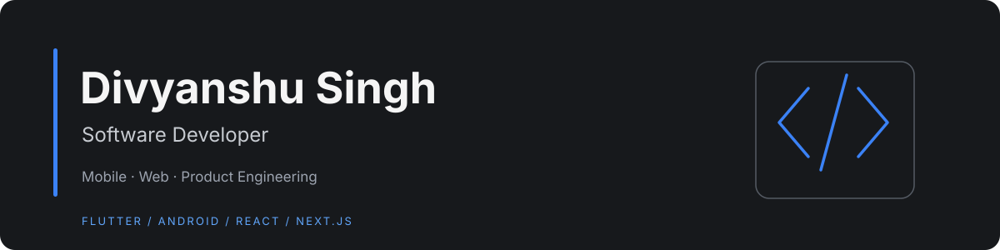

  <a href="#about">About</a> ·
  <a href="#toolbox">Toolbox</a> ·
  <a href="#featured-work">Featured work</a> ·
  <a href="#github-activity">GitHub activity</a> ·
  <a href="#connect">Connect</a>

## About

I'm a software developer interested in building practical products across **mobile and web**. My work spans Android and Flutter applications, modern React/Next.js interfaces, API integrations, and local-first data workflows.

I enjoy the full product loop: understanding a problem, shaping the experience, implementing the application, and improving its reliability.

- **Primary areas:** Mobile development, frontend engineering, API integration
- **Currently exploring:** AI-assisted development, interactive 3D, game development
- **Approach:** Build useful things, keep learning, improve through iteration

## Toolbox

| Area | Technologies |
|---|---|
| **Mobile** | Flutter · Dart · Kotlin · Java · Android |
| **Web** | React · Next.js · TypeScript · JavaScript · Tailwind CSS |
| **Backend & services** | REST APIs · Firebase · Retrofit · Volley |
| **Data** | SQLite · Room · MongoDB |
| **Engineering** | MVVM · Repository Pattern · ViewModel · LiveData · Git |

## Featured work

A selection of projects from my repositories. Expand each project to see its focus and implementation details.

<strong>01 · NullMark</strong> — File privacy &amp; sanitization

A browser-based utility for inspecting and processing files locally.

- Image, PDF, audio, code, and text workflows
- Batch processing and reporting
- Metadata inspection and selected metadata removal

**Built with:** Next.js · React · TypeScript · Tailwind CSS · pdf-lib

[Explore NullMark →](https://github.com/divyanshu15/nullmark)

<strong>02 · Panji Mobile</strong> — Invoice &amp; business workflows

A Flutter application prototype for invoice and vendor management.

- Invoice creation and document scanning
- Vendor records and invoice details
- SQLite persistence and EMI calculator interface

**Built with:** Flutter · Dart · SQLite · GetX

[Explore Panji Mobile →](https://github.com/divyanshu15/panji-mobile)

<strong>03 · ShopSaver</strong> — Coupon management

An Android coupon application combining authentication, API integration, and local storage.

- Firebase phone authentication
- Coupon management and archiving
- Room persistence with ViewModel and LiveData

**Built with:** Kotlin · Firebase · Retrofit · Room

[Explore ShopSaver →](https://github.com/divyanshu15/ShopSaver)

<strong>04 · Food-Runner</strong> — Food ordering app

An Android client covering the core customer food-ordering flow.

- Restaurant and menu browsing
- Cart, favorites, and order history
- Authentication and local preferences

**Built with:** Kotlin · Android · Volley · Room

[Explore Food-Runner →](https://github.com/divyanshu15/Food-Runner)

<strong>05 · NearByPlaces</strong> — Location-based discovery

An Android app for discovering nearby places using device location and Google Maps.

- Fused device location
- Nearby place discovery and map markers
- Google Maps and Places API integration

**Built with:** Kotlin · Google Maps · Places API · Retrofit

[Explore NearByPlaces →](https://github.com/divyanshu15/NearByPlaces)

<strong>06 · GroceryApp</strong> — Grocery list management

A lightweight local grocery manager built around Android's MVVM architecture.

- Add and remove grocery items
- Quantity and price management
- Reactive local database updates

**Built with:** Kotlin · Room · LiveData · ViewModel

[Explore GroceryApp →](https://github.com/divyanshu15/GroceryApp)

<strong>07 · NewsApp</strong> — News reader

An Android news reader with category navigation and article browsing.

- Category-based headlines
- Retrofit API integration
- Article thumbnails and in-app browsing

**Built with:** Java · Android · Retrofit · Gson · Glide

[Explore NewsApp →](https://github.com/divyanshu15/NewsApp)

<strong>08 · GFGAssignment</strong> — RSS news reader

An Android RSS reader that converts feed content into a readable article list.

- RSS feed integration
- Article list and thumbnails
- Swipe-to-refresh

**Built with:** Kotlin · Retrofit · LiveData · ViewModel · Glide

[Explore GFGAssignment →](https://github.com/divyanshu15/GFGAssignment)

<a href="#top">Back to top ↑</a>

## GitHub activity

Profile metrics are refreshed automatically by the GitHub Actions workflow in this repository.

## What I'm exploring

- Scalable application architecture and software quality
- Modern full-stack product development
- AI-assisted engineering and automation
- Interactive 3D experiences and game development

## Connect

Build with purpose. Learn continuously. Improve relentlessly.

